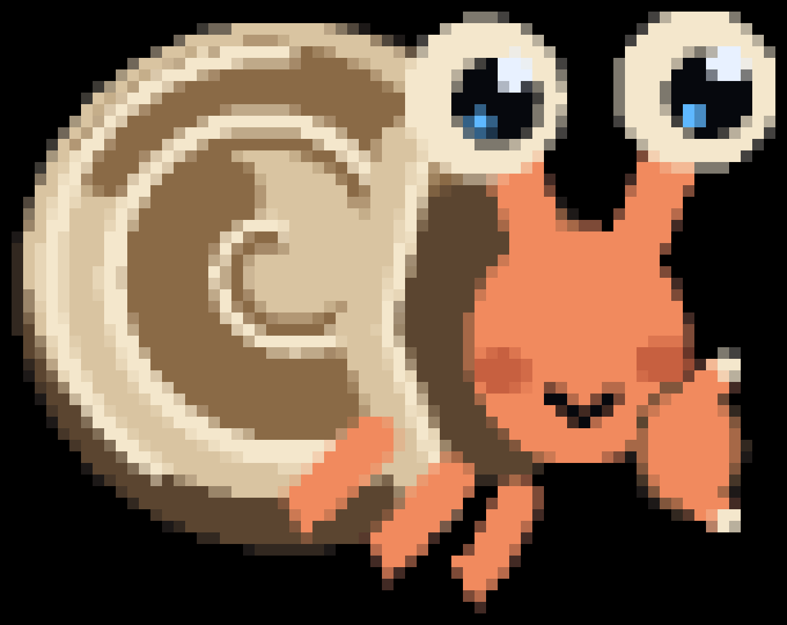

# krd —— 把 Mac 桌面塞进终端

[English](README.md) | 简体中文

[](https://github.com/zzjcool/krd/actions/workflows/ci.yml)
[](https://github.com/zzjcool/krd/releases)
[](#license)
[](#环境要求)

> **开发中。** 这个项目还在持续开发，功能在不断加，行为也可能在版本之间变化。欢迎提 issue
> 反馈问题，见 [CONTRIBUTING.md](CONTRIBUTING.md)。

ScreenCaptureKit 抓屏，kitty 图形协议把画面送进终端，鼠标键盘从 stdin 读回来用 `CGEvent` 注入。
没有 VNC、没有编解码器、不开额外端口、不用装客户端 —— 你手上那个 SSH 会话本身就是客户端。

<p align="center">
  
</p>

```bash
ssh -t host krd --fps 20        # 退出按 Ctrl-\
```

## 安装

```bash
curl -fsSL https://raw.githubusercontent.com/zzjcool/krd/main/install.sh | sh
```

脚本会下载最新 release（单个通用二进制，Apple Silicon + Intel），校验 sha256，用稳定身份本地签名，
装到 `~/bin/krd`。

```bash
curl -fsSL … | sh -s -- --prefix /usr/local/bin      # 换个安装目录
curl -fsSL … | sh -s -- --version v0.1.1             # 装指定版本
curl -fsSL … | sh -s -- --from-source                # 直接从源码编译
```

细节和失败排查见 [docs/DEPLOY.zh-CN.md](docs/DEPLOY.zh-CN.md)；脚本本身就是普通的 `sh`
（[install.sh](install.sh)）。

## 用法

```bash
krd                          # 落地屏：上面是显示器，下面是最近用过的窗口，两边都用右边竖条滚
krd --mirror --fps 20        # 整块屏当一张图镜像，也就是原来的默认行为
krd --list                   # 列出显示器与窗口，背板条目会标出来
krd --window Safari          # 只镜像一个窗口（背板窗口会被拒绝，而不是给黑屏）
krd --zoom 2                 # 看一半的屏幕、按两倍密度显示（在采集端裁剪）
krd --zoom 3 --zoom-at 200,300   # ……以某个全局屏幕点为焦点
krd --zoom 2 --zoom-follow   # ……指针碰到画面边缘时平移
# 采集缩放默认是自适应的：链路跟得上就是 1，跟不上降到 0.5/0.25，于是慢链路保持 20 fps
# 而不是冻住。--scale 1 钉死不动，--scale 0.5 固定半分辨率。
krd --scale 1                # 永不自适应：始终用 pane 自己的像素
krd --scale 0.5              # 每边只采一半像素，交给终端放大：彩色重内容少 4 倍字节，文字明显变糊
krd --display 1 --fps 30
krd --unfocused-fps 1        # pane 没焦点时画面降到这个帧率（终端用 DECSET 1004 上报焦点：
                             # CSI I 是获得焦点、CSI O 是失去焦点），默认 1 fps，0 就彻底冻住，
                             # 敲一下键或点一下鼠标画面就回来
krd --no-input               # 只看不动
krd --no-quantise           # 保持严格无损（照片类画面字节数约 2.3 倍）——这是镜像的无损，
                            # 落地屏要无损是 --wall-quality 100
krd --wall-quality 70       # 落地屏那几张图的质量：100 是无损，70（默认）是 5-5-5，50 是 4-4-4。
                            # 只降位深、不改分辨率：画面依旧正好铺满自己的格子，桌面类内容首屏字节
                            # 少 20-30%（实测 70 少 20.7%、50 少 27.9%），纯色平坦内容几乎没有变化，
                            # 既不会裁切也不会出现接缝。它是独立开关（--quality 是镜像的），
                            # 点进某个窗口再回来也不会丢
krd --cursor                 # 把目标端的指针画进画面（默认不画：画了之后鼠标每动一下都会弄脏瓦片）
krd --dev                    # TUI 层：画面下面一条状态栏 + 面板。它会打开镜像：墙占满了每一行，
                             # 所以 `krd --wall --dev` 会被拒绝并在拒绝里说明，而不是悄悄丢掉这个开关
krd --mock --dev             # 同上，但屏幕是模拟的：不需要任何权限
krd --wall --mock            # 落地屏 + 假窗口列表（12 张卡、中日文与 emoji 标题、一个被隐去的标题、
                             # 一块遮罩、两块屏）：不需要授权，图在进程内画
wall                         # 同一个落地屏的另一个名字（安装脚本建的软链：今天 wall 和 krd 一样）
krd --symbols ascii          # 每个字形都只占一格（终端把 ▲ 画成两格宽时用）
krd --debug                  # 统计写日志文件，不会打到画面上
krd --format rgba            # 终端不认 f=24 时退回 f=32
krd --passthrough on         # 在 tmux/screen 里：把每条图像转义包进 DCS passthrough，让 tmux 转发出去
                             # （auto|on|off，或 KRD_PASSTHROUGH；默认 auto：TERM 以 tmux 或 screen
                             # 开头时打开，其它终端关着；见 TROUBLESHOOTING §1c）
krd --bench                  # 在合成帧上给编码器计时，不需要终端
```

`--mock` 单独用时把 ScreenCaptureKit 换成进程内画的桌面（`--mock-size WxH`，默认 1920x1200）：
瓦片、脏矩形、编码器、摆放和 TUI 层都是真代码，只有像素是合成的，所以不需要权限、也不会停（`make dev-mock`）。
加上 `--wall` 它改为提供**落地屏的窗口列表**（`WallSource.mockModel`），图仍在进程内画：
在没有屏幕录制授权的机器上看墙的文本层（翻页、中日文与 emoji 标题、被隐去的标题、遮罩、两块屏）就靠它。

落地屏上只有鼠标这一套词汇：右边竖条滚舞台和卡片带（点一下翻一页，滚轮一格一项），
**点一张图就进入那个窗口的镜像**——krd 直接 `exec` 自己变成 `krd --window <id>`（始终只有一个采集客户端）。
镜像顶部有一条 macOS 风格的顶栏：窗口名、实时码率、**我们测出来的延迟**（`38 ms`，终端 `CSI 5n` 往返；没测到就是 `— ms`）、
时钟，以及 **`[ ≡ ]`——点开是三个滑杆**（颜色＝位深，质量＝编码器多舍得花它，帧数＝1…20）。滑杆上的每一格都是一次点击，
改完立即生效；点一下就**钉住**这条轴，没有调速器再把它挪回去，再点 `[ ≡ ]` 收起。点 `[ - ]`（或者按 `Ctrl-\`）把窗口缩回墙里，
还停在原来那一页。画面在框里居中。

退出按 **`Ctrl-\`**；`Ctrl-C` 会转发给远程桌面，和真机一致。
完整参数、调优开关和诊断开关在 [docs/ARCHITECTURE.zh-CN.md](docs/ARCHITECTURE.zh-CN.md) 和
[docs/TESTING.zh-CN.md](docs/TESTING.zh-CN.md)。

### Headless：把 Mac 读成文本

同一个二进制，不出画面。`krd ax` 走无障碍树并把结果打成文本，agent 不需要图像就能读窗口、
操作控件——而且不需要屏幕录制授权，那只给镜像模式用。

```bash
krd ax doctor                # 辅助功能是否已授权、窗口服务器是否应答
krd ax windows               # 应用、pid、窗口序号、标题、位置尺寸
krd ax tree --app Finder -d 3 -i    # 单个窗口、浅层、只出可操作节点
krd ax tree --app Finder --json     # 同上，给程序读
krd ax screen                # 每个可见窗口一行，外加当前焦点
```

每个节点一行 —— `@e3  button  "Save"  value="hi"  [120,80 64x24]  press`，ref 在本次 dump
生命周期内稳定。文本一律消毒：窗口标题里的 ESC 序列会被替换掉，不会打到终端上。测量数据见
[docs/research-ax-text-channel.md](docs/research-ax-text-channel.md)。

**退出码** —— 一共六个：这张表和 `krd ax --help` 里那张是同一张（这里是它的中文译文），
[docs/TROUBLESHOOTING.zh-CN.md](docs/TROUBLESHOOTING.zh-CN.md) 的 §6 也一模一样：

```text
exit  0  ok —— krd ax doctor 的诊断也是绿的
      2  用法错：不认识的 flag 或子命令，或者值缺失/格式不对
      3  没有辅助功能（Accessibility）权限
      4  辅助功能 API 不应答：Mac 睡了或锁屏、窗口服务器没了、能应答的应用全卡住
      5  没有匹配到：查询、应用或 ref 什么都没找到（krd ax windows 列表为空照样退 0）
      6  节点拒绝了这个动作，或者应用读回来的值不一样

krd ax doctor 诊断不通过时退出 3 或 4（文本和 --json 都一样），而不是 0，所以
krd ax doctor && krd ax windows 是一条在坏机器上绝不会过的健康检查。
```

`--json` 只是换格式，不是第二套契约：文本和 JSON 退出的码是同一个，stdout 在任何结局下
都只有**一个** JSON 对象（`krd ax --json --help` 例外，它照旧回文本）—— 成功时是
`"ok": true` 加原有字段，失败时是

```json
{"ok": false, "error": {"code": "environment", "exit": 4,
                         "message": "the accessibility API is not answering (cannotComplete)",
                         "next": "the Mac may be asleep or at the login window…",
                         "ax": "cannotComplete"}}
```

（为了好看换了行、`next` 也截短了；真实输出是一行一个对象）

其中 `code` 是 `usage|permission|environment|notFound|notActionable`（一个码对应一个词），
`exit` 就是那个数字，`ax` 是 AXError 名字（`cannotComplete`），只出现在权限类和环境类；
码 `5`、`6` 把自己的 AXError 名字写在 `message` 里。以前只认名字（`doctor` 旧载荷里的 `error`
字段）的调用方，现在读 `error.ax`。散文一律走 stderr；`press`/`set` 成功时回
`{"ok":true,"command":"press|set","ref":"@e7","label":"…","before":"…","after":"…","elapsedMs":3}`
（`press` 在元素消失时 `after` 是 `null`、同时多一个 `note`，写进去了但回读没变时也是这个 `note`；
`set` 遇到元素消失宁可退 `6` 也不报一个空回读，另外会回写进去的 `value`），其余形状见 `krd ax --help`。
字段值就是二进制里的英文串（`message` / `next` / `ax` 不翻译）。

## 环境要求

- macOS 14 或更新版本
- 终端要支持 kitty 图形协议：**rex**、**Ghostty**、**kitty**、**WezTerm**；Terminal.app 不支持
- 首次运行要授权**屏幕录制**（采集）和**辅助功能**（注入），安装脚本会提示。细节见
  [docs/DEPLOY.zh-CN.md](docs/DEPLOY.zh-CN.md)

### 终端

| | 图形协议 | 键盘协议 |
|---|---|---|
| rex | kitty | ? —— 跑一下探针 |
| Ghostty | kitty | kitty（flags 15）† |
| kitty | kitty | kitty（flags 15）† |
| WezTerm | kitty | kitty（flags 15）† |
| Terminal.app | — | legacy（不应答） |

“kitty” 表示 `Cmd` 组合、按键释放和连发都能收到；“legacy” 表示收不到，krd 走 0.1.2 之前的那条
未改动的编码——两者都是受支持的状态。† = 依据各终端自己的文档；用
`python3 probe/kkeyboard.py` 可以在你真正在用的终端里得到确切答案。

## 状态

| | |
|---|---|
| 可用 | 瓦片脏更新（静止画面 0 字节/秒）、指针跟随、左中右三键、双击、滚轮、键盘、应答握手的终端上的 kitty 键盘协议（`Cmd`、连发、释放）、窗口级镜像（输入直接投给该窗口所属进程）、显示器集合变化（插拔 / 改分辨率 / 合盖）就地重启采集、SSH |
| 粗糙 | 全密度下的大面积高速运动：最坏情况 13.58 MB/帧，成本见 [research-photo-bandwidth](docs/research-photo-bandwidth.zh-CN.md)；Herdr 的图像删除语义 |
| 可用（带宽） | 用分辨率换带宽后，彩色重内容已经可用：不可压 tile 降到 5-6-5（`Z_HUFFMAN_ONLY`，不改协议）省 **1.29×**，`--scale 0.5` 只采四分之一的像素省 **3.98×** —— 合起来 20 fps 下 **68 MB/s**，落在本地 pty 的 103 MB/s 之内，且指针映射不变 |
| 可用（剪贴板） | 剪贴板桥，`--clipboard=in|out|both` 显式打开：镜像桌面里复制 = 给本地终端发一条 OSC 52
（`in`）；`Ctrl-V` = 向终端索取剪贴板、放进镜像端 pasteboard 再投 `Cmd-V`（`out`，需要终端支持 OSC 52 读回，
不支持就用 `--clipboard-paste <file>`） |
| 可用（输入法/CJK） | `--ime`（`auto` / `raw` / `unicode`）：物理键直接发给目标端，由**它的**输入法组合
（候选窗画在镜像画面里）；没有按键的字符退回注入文本，并打一行日志——见 TROUBLESHOOTING §19 |
| 还没做 | 把多块显示器拼成一张画面（一个会话同一时刻只跟随一块屏） |

## 文档

| | |
|---|---|
| [ARCHITECTURE](docs/ARCHITECTURE.zh-CN.md) | 采集 → 瓦片 → 协议 → 注入，以及命令行与环境变量 |
| [PROTOCOL](docs/PROTOCOL.zh-CN.md) | 每一条发出去的转义序列，以及为什么 |
| [TESTING](docs/TESTING.zh-CN.md) | 自检、瓦片定位标定、怎么验一个新终端 |
| [ENCODING](docs/ENCODING.zh-CN.md) | 字节和毫秒花在哪，以及背后的基准测试 |
| [BENCHMARK](docs/BENCHMARK.md) | 基准分层、预算阈值，以及这里「快」到底指什么 |
| [调研：彩色带宽](docs/research-photo-bandwidth.zh-CN.md) | 彩色重内容每帧 13.58 MB 花在哪、每个方案值多少，附测量脚本 |
| [TROUBLESHOOTING](docs/TROUBLESHOOTING.zh-CN.md) | 47 个现象及其根因 |
| [DEPLOY](docs/DEPLOY.zh-CN.md) | 安装、权限、签名、远端 SSH |

## 参与

见 [CONTRIBUTING.md](CONTRIBUTING.md)；安全问题见 [SECURITY.md](SECURITY.md)。

## 吉祥物

<p align="center">
  
</p>

**一只寄居蟹** —— 不只是因为它在那几版草稿里最可爱。

`SSH` 的全称是 *secure shell*，而 shell 就是寄居蟹住的那个壳。krd 不带自己的客户端、不开新端口、
不装编解码器：它把你的 Mac 桌面搬进你已经打开的那个 shell 里。关掉、重连、换个终端 —— 蟹走出来，
背上还是同一张桌面。整个产品就是这一只动物。

其余的地方也对得上：钳子是一次抓屏，一次一帧；两根眼柄上的眼睛是它必须盯着的两样东西
（它在读的那块屏、它在画的那个终端）；壳上那圈螺纹，和发送到线上去的 tile 用同一种圆角格子画。

**同一份几何，由终端自己画两遍** —— 拟物版是 24-bit 半块像素，字符版是每格一个 ASCII 字符 ——
所以这个 logo 和产品本身是同一个材料做的。`node docs/brand/tui/logo-tui.mjs` 可以看它动起来。

## 联系

X（Twitter）：[**@zzjcoo**](https://x.com/zzjcoo)

Bug 和功能建议请开 [issue](https://github.com/zzjcool/krd/issues)，比私信好追踪。

## 许可

MIT，见 [LICENSE](LICENSE)。
