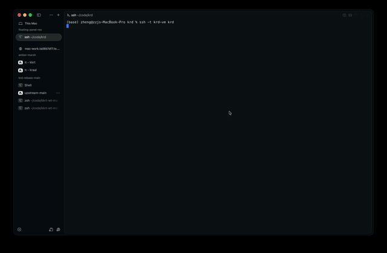

# krd —— 把 Mac 桌面塞进终端

[English](README.md) | 简体中文

[](https://github.com/zzjcool/krd/actions/workflows/ci.yml)
[](https://github.com/zzjcool/krd/releases)
[](#license)
[](#环境要求)

> **开发中。** 这个项目还在持续开发，功能在不断加，行为也可能在版本之间变化。欢迎提 issue
> 反馈问题，见 [CONTRIBUTING.md](CONTRIBUTING.md)。

ScreenCaptureKit 抓屏，kitty 图形协议把画面送进终端，鼠标键盘从 stdin 读回来用 `CGEvent` 注入。
没有 VNC、没有编解码器、不开额外端口、不用装客户端 —— 你手上那个 SSH 会话本身就是客户端。

<p align="center">
  
</p>

```bash
ssh -t host krd --fps 20        # 退出按 Ctrl-\
```

## 安装

```bash
curl -fsSL https://raw.githubusercontent.com/zzjcool/krd/main/install.sh | sh
```

脚本会下载最新 release（单个通用二进制，Apple Silicon + Intel），校验 sha256，用稳定身份本地签名，
装到 `~/bin/krd`。

```bash
curl -fsSL … | sh -s -- --prefix /usr/local/bin      # 换个安装目录
curl -fsSL … | sh -s -- --version v0.1.1             # 装指定版本
curl -fsSL … | sh -s -- --from-source                # 直接从源码编译
```

细节和失败排查见 [docs/DEPLOY.zh-CN.md](docs/DEPLOY.zh-CN.md)；脚本本身就是普通的 `sh`
（[install.sh](install.sh)）。

## 用法

```bash
krd --fps 20                 # 镜像指针所在的那块屏
krd --list                   # 列出显示器与窗口，背板条目会标出来
krd --window Safari          # 只镜像一个窗口（背板窗口会被拒绝，而不是给黑屏）
krd --zoom 2                 # 看一半的屏幕、按两倍密度显示（在采集端裁剪）
krd --zoom 3 --zoom-at 200,300   # ……以某个全局屏幕点为焦点
krd --zoom 2 --zoom-follow   # ……指针碰到画面边缘时平移
krd --display 1 --fps 30
krd --no-input               # 只看不动
krd --cursor                 # 把目标端的指针画进画面（默认不画：画了之后鼠标每动一下都会弄脏瓦片）
krd --dev                    # TUI 层：画面下面一条状态栏 + 面板
krd --mock --dev             # 同上，但屏幕是模拟的：不需要任何权限
wall                         # 落地屏：显示器 + 最近用过的窗口（等于 krd --wall）
krd --wall                   # 全拼写法（wall 是安装脚本建的软链）
krd --wall --symbols ascii   # 每个字形都只占一格（终端把 ▲ 画成两格宽时用）
krd --debug                  # 统计写日志文件，不会打到画面上
krd --format rgba            # 终端不认 f=24 时退回 f=32
krd --bench                  # 在合成帧上给编码器计时，不需要终端
```

退出按 **`Ctrl-\`**；`Ctrl-C` 会转发给远程桌面，和真机一致。
完整参数、调优开关和诊断开关在 [docs/ARCHITECTURE.zh-CN.md](docs/ARCHITECTURE.zh-CN.md) 和
[docs/TESTING.zh-CN.md](docs/TESTING.zh-CN.md)。

### Headless：把 Mac 读成文本

同一个二进制，不出画面。`krd ax` 走无障碍树并把结果打成文本，agent 不需要图像就能读窗口、
操作控件——而且不需要屏幕录制授权，那只给镜像模式用。

```bash
krd ax doctor                # 辅助功能是否已授权、窗口服务器是否应答
krd ax windows               # 应用、pid、窗口序号、标题、位置尺寸
krd ax tree --app Finder -d 3 -i    # 单个窗口、浅层、只出可操作节点
krd ax tree --app Finder --json     # 同上，给程序读
krd ax screen                # 每个可见窗口一行，外加当前焦点
```

每个节点一行 —— `@e3  button  "Save"  value="hi"  [120,80 64x24]  press`，ref 在本次 dump
生命周期内稳定。退出码：`0` 成功、`2` 用法错、`3` 没有辅助功能授权、`4` 窗口服务器不可达、
`5` 没有匹配到。文本一律消毒：窗口标题里的 ESC 序列会被替换掉，不会打到终端上。测量数据见
[docs/research-ax-text-channel.md](docs/research-ax-text-channel.md)。

## 环境要求

- macOS 14 或更新版本
- 终端要支持 kitty 图形协议：**rex**、**Ghostty**、**kitty**、**WezTerm**；Terminal.app 不支持
- 首次运行要授权**屏幕录制**（采集）和**辅助功能**（注入），安装脚本会提示。细节见
  [docs/DEPLOY.zh-CN.md](docs/DEPLOY.zh-CN.md)

### 终端

| | 图形协议 | 键盘协议 |
|---|---|---|
| rex | kitty | ? —— 跑一下探针 |
| Ghostty | kitty | kitty（flags 15）† |
| kitty | kitty | kitty（flags 15）† |
| WezTerm | kitty | kitty（flags 15）† |
| Terminal.app | — | legacy（不应答） |

“kitty” 表示 `Cmd` 组合、按键释放和连发都能收到；“legacy” 表示收不到，krd 走 0.1.2 之前的那条
未改动的编码——两者都是受支持的状态。† = 依据各终端自己的文档；用
`python3 probe/kkeyboard.py` 可以在你真正在用的终端里得到确切答案。

## 状态

| | |
|---|---|
| 可用 | 瓦片脏更新（静止画面 0 字节/秒）、指针跟随、左中右三键、双击、滚轮、键盘、应答握手的终端上的 kitty 键盘协议（`Cmd`、连发、释放）、窗口级镜像（输入直接投给该窗口所属进程）、显示器集合变化（插拔 / 改分辨率 / 合盖）就地重启采集、SSH |
| 粗糙 | 大面积高速运动：最坏情况 13.58 MB/帧，成本见 [research-photo-bandwidth](docs/research-photo-bandwidth.zh-CN.md)（便宜的解法是 16 位 tile + 缩小采集，而不是编解码器）；Herdr 的图像删除语义 |
| 可用（剪贴板） | 剪贴板桥，`--clipboard=in|out|both` 显式打开：镜像桌面里复制 = 给本地终端发一条 OSC 52
（`in`）；`Ctrl-V` = 向终端索取剪贴板、放进镜像端 pasteboard 再投 `Cmd-V`（`out`，需要终端支持 OSC 52 读回，
不支持就用 `--clipboard-paste <file>`） |
| 可用（输入法/CJK） | `--ime`（`auto` / `raw` / `unicode`）：物理键直接发给目标端，由**它的**输入法组合
（候选窗画在镜像画面里）；没有按键的字符退回注入文本，并打一行日志——见 TROUBLESHOOTING §19 |
| 还没做 | 把多块显示器拼成一张画面（一个会话同一时刻只跟随一块屏） |

## 文档

| | |
|---|---|
| [ARCHITECTURE](docs/ARCHITECTURE.zh-CN.md) | 采集 → 瓦片 → 协议 → 注入，以及命令行与环境变量 |
| [PROTOCOL](docs/PROTOCOL.zh-CN.md) | 每一条发出去的转义序列，以及为什么 |
| [TESTING](docs/TESTING.zh-CN.md) | 自检、瓦片定位标定、怎么验一个新终端 |
| [ENCODING](docs/ENCODING.zh-CN.md) | 字节和毫秒花在哪，以及背后的基准测试 |
| [BENCHMARK](docs/BENCHMARK.md) | 基准分层、预算阈值，以及这里「快」到底指什么 |
| [调研：彩色带宽](docs/research-photo-bandwidth.zh-CN.md) | 彩色重内容每帧 13.58 MB 花在哪、每个方案值多少，附测量脚本 |
| [TROUBLESHOOTING](docs/TROUBLESHOOTING.zh-CN.md) | 47 个现象及其根因 |
| [DEPLOY](docs/DEPLOY.zh-CN.md) | 安装、权限、签名、远端 SSH |

## 参与

见 [CONTRIBUTING.md](CONTRIBUTING.md)；安全问题见 [SECURITY.md](SECURITY.md)。

## 联系

X（Twitter）：[**@zzjcoo**](https://x.com/zzjcoo)

Bug 和功能建议请开 [issue](https://github.com/zzjcool/krd/issues)，比私信好追踪。

## 许可

MIT，见 [LICENSE](LICENSE)。
